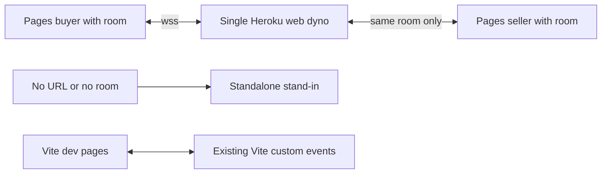

# Closed Inner Loop: Live Relay

Continue the Closed Inner Loop: work one task at a time, keep tasks updated,
finish verification, run Phase 3 review, and complete every task before stopping.

## Task Ledger

- [x] [Phase 1 Investigate] Read link, story, stage, Vite, Pages and harness docs.
- [x] [Phase 1 Plan audit] Check opt-in configuration, no shared default, handshake race, room bounds and single-process deployment assumptions.
- [x] [Phase 2 Implement] Add relay, shared validation and browser transport without UI expansion.
- [x] [Phase 2 Implement] Add tests and deployment / harness documentation.
- [x] [Phase 2 Verify] Live-socket tests, browser lifecycle tests, normal/share/configured builds.
- [x] [Phase 3 Review:code/security] Review final diff and connection/room lifecycle (self-review; independent dispatch unavailable).
- [x] [Phase 3 Evidence] Record final results and residual deployment verification.

## Investigation and Plan

Feature request for a synthetic prototype, no GUS work item. Existing Vite
custom events broadcast to dev pages; production has no transport. Story has
seven owned beats and fifteen bounded jump steps. Stage remounts story on jump.
Stand-in is already mounted when peer is absent. Personal Pages workflow already
creates buyer/seller route entries. Explicit user approval supersedes the old
internal-only hosting rule for this copy.

Add only a Node ws relay, health endpoint and Heroku web process; share beat
ownership/validation with the browser; retain Vite precedence. Production needs
both a relay URL and explicit room. Connect once per mounted side, hello on open,
retry after close, no stale queued beats. New pairing resets both peers and
timeout restores stand-in. UI remains unchanged. Test socket isolation, malformed
traffic, origin and resource limits, reconnect/cleanup; typecheck/build separately.

## Tool Availability

Innerloop investigation, execute, review and task-template references were read;
Ralph was loaded. Task/subagent dispatch tools are not exposed in this session.
This file is the task ledger. Independent review cannot be claimed; explicit
code/security self-review and executable tests are used instead.

## Evidence

Initial verification: 7/7 node:test cases passed; normal build/typecheck passed.
Post-review verification results will be recorded below. Existing font-resolution
and large-chunk build warnings are unrelated to the relay.
`npm audit` reports two existing high-severity toolchain dependencies: Vite 8.3.0
and source-map-js. No advisory reported for the added ws dependency. Toolchain
upgrade is out of scope; the runtime does not serve Vite or compile source maps.

## Final Verification and Review

- `npm test`: 8 tests, 8 pass, 0 fail (final run ~302 ms).
- `npm run build`: TypeScript and production build pass after final validation fix.
- `npm run build:share`: pass, standalone single-file build.
- `VITE_RELAY_URL=wss://relay.example.invalid/ npm run build -- --base=/a2a-b2b-vision-v2/`: pass, configured Pages build (placeholder endpoint only; no network request).
- `git diff --check`: pass.
- Live local sockets exercise health, room isolation, hello, owned beat delivery,
  jump/pause, malformed JSON, inherited-property message kind, unknown beat,
  binary and oversized payload, identity change, rate limit, empty-room cleanup,
  missing/disallowed origins, room/client caps, hello expiry and duplicate sides.
- Deterministic browser transport test exercises no early hello, hello on open,
  reconnect hello, malformed input suppression, retry cancellation and handler cleanup.
- Code/security review fixed initial stand-in grace, idle socket expiry and
  inherited-property lookup for message kinds. Reviewed room deletion, no payload
  persistence, backpressure, fixed identities, origin trust limits, single-dyno
  constraint, socket cleanup and repeated pairing resets.
- No independent reviewer available. No deployed endpoint or two-device browser
  UI was tested. These are explicitly remaining deployment smoke checks, not
  claimed completed work. Actual React handshake/fallback is typechecked and
  reviewed, not covered by a mounted React/browser integration test.
- No commits, pushes, hosting changes, secrets, or UI feature expansion.

Verdict: implementation locally verified; deployment verification pending.
Remaining user actions are in `docs/live-relay.md`: authorized commit/push,
dashboard GitHub deploy, obtain exact generated hostname, one web dyno,
repository variable and Pages rebuild, two-device room/fallback smoke test.

## Reviewer P1 Follow-Up

- [x] Regression tests first: object-valued kind/beat with `toString: null`,
  real WebSocket closure plus subsequent health checks, raw TCP upgrade requests
  with malformed absolute target `http://[`, absolute and protocol-relative targets.
- Red evidence: validator test threw `TypeError: Cannot convert object to primitive
  value` at `Object.hasOwn`; pre-fix socket/raw upgrade test runs failed to complete
  and were terminated by command timeouts. These are failures, not successful checks.
- [x] Fix: require string kind/beat before property lookup, contain JSON parsing
  and validation exceptions inside the socket message callback; check origin first,
  require origin-form target, catch URL parsing errors and respond HTTP 400.
- [x] Verification: `npm test` 11/11 pass, 0 failures (~337 ms);
  `npm run build` TypeScript/production build pass; `git diff --check` pass.
  Existing font-resolution and large-chunk warnings remain unchanged.
- The raw tests prove disallowed origins return 403 before malformed URL handling;
  allowed origins with malformed/non-origin-form targets return 400. Each attack
  is followed by HTTP 200 `/health` with `{ "ok": true }` from the same relay.
- No commit/push or hosting changes. Deployment smoke checks remain pending.
